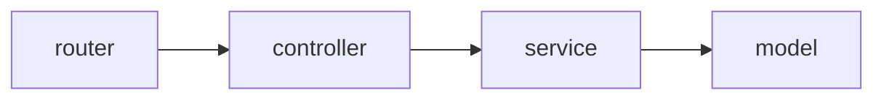

# express-ts-starter

Qayta ishlatiladigan **Express 5 + TypeScript** backend starter'i: qatlamli struktura, DI, DTO validatsiyasi, tiplangan muhit o'zgaruvchilari, tayyor test infratuzilmasi va interaktiv API hujjati.

| Qatlam      | Vosita                                               |
| ----------- | ---------------------------------------------------- |
| Server      | Express 5                                            |
| Til / build | TypeScript 5, SWC (`tsc` zaxira variant sifatida)    |
| Baza        | MongoDB + Mongoose 8                                 |
| DI          | typedi                                               |
| Validatsiya | class-validator + class-transformer (DTO), zod (env) |
| Testlar     | Vitest 4 + supertest + mongodb-memory-server         |
| Hujjat      | OpenAPI 3.0 + Swagger UI (`/docs`)                   |
| Sifat       | ESLint 9 (flat config), Prettier, husky              |

---

## ⚠️ Bu starter ataylab yarim bo'sh

Ikkita entity bor va ular **turli maqsadga** xizmat qiladi:

- **`product` — to'liq ishlaydigan namuna.** CRUD, validatsiya, xatolar, testlar — hammasi joyida. Yangi entity yozganda shundan nusxa oling.
- **`user` — ataylab bo'sh skelet.** `UserService` metodlari `Not implemented` tashlaydi, `CreateUserDto` bo'sh, model schema'si bo'sh. **Bu bug emas.** Har bir yangi loyiha o'z domenini shu skelet ustiga yozadi.

Shuning uchun `GET /users` → `500`, `POST /users` → `400` — kutilgan natija.

---

## Talablar

- **Node.js 20+** (ishlab chiqishda 24.x sinovdan o'tgan)
- **MongoDB** — lokal o'rnatilgan yoki Docker orqali:

```bash
docker run -d --name mongo -p 27017:27017 mongo:7
```

Testlar uchun alohida baza kerak emas — `mongodb-memory-server` o'zi ko'taradi.

---

## Tez boshlash

```bash
git clone git@github.com:Al1yev/express-ts-starter.git
cd express-ts-starter
npm install

cp .env.example .env.dev     # qiymatlarni o'zingizga moslang
npm run dev
```

Tekshirish:

```bash
curl http://localhost:5000/health
# {"success":true,"message":"OK","data":{"status":"ok","db":"up",...}}
```

So'ng brauzerda **<http://localhost:5000/docs>** — barcha endpointlar interaktiv hujjatda.

---

## Muhit o'zgaruvchilari

Konfiguratsiya `.env.<NODE_ENV>` faylidan o'qiladi — ya'ni `npm run dev` → `.env.dev`, `npm start` → `.env.prod`, testlar → `.env.test`. Schema: [`src/config/env.config.ts`](./src/config/env.config.ts).

| O'zgaruvchi | Tip                       | Majburiy | Namuna             | Izoh                                           |
| ----------- | ------------------------- | -------- | ------------------ | ---------------------------------------------- |
| `NODE_ENV`  | `dev` \| `prod` \| `test` | ha       | `dev`              | npm skriptlari o'zi qo'yadi; berilmasa `dev`   |
| `HOST`      | URL                       | ha       | `http://localhost` | to'liq URL bo'lishi shart (`z.string().url()`) |
| `PORT`      | son                       | ha       | `5000`             | faqat raqamlardan iborat satr                  |
| `DB_HOST`   | satr                      | ha       | `127.0.0.1`        |                                                |
| `DB_PORT`   | son                       | ha       | `27017`            |                                                |
| `DB_NAME`   | satr                      | ha       | `test-app`         |                                                |

Qiymatlar zod bilan **dastur ko'tarilishidan oldin** tekshiriladi. Bittasi yetishmasa yoki formati noto'g'ri bo'lsa jarayon `process.exit(1)` bilan to'xtaydi — yarim sozlangan holatda ishga tushmaydi.

`.env.test` **ataylab** repozitoriyga qo'shilgan (`.gitignore` da `!/.env.test`), chunki unda maxfiy narsa yo'q va testlar hech qanday qo'lda sozlashsiz ishlashi kerak.

---

## Skriptlar

| Skript                      | Nima qiladi                                           |
| --------------------------- | ----------------------------------------------------- |
| `npm run dev`               | `tsx watch` bilan ishga tushiradi, `.env.dev`         |
| `npm run build`             | SWC bilan `dist/` ga kompilyatsiya (asosiy build)     |
| `npm run build:tsc`         | `tsc` + `tsc-alias` — zaxira build yo'li              |
| `npm start`                 | build qiladi va `.env.prod` bilan ishga tushiradi     |
| `npm test`                  | barcha testlarni bir marta ishga tushiradi            |
| `npm run test:watch`        | watch rejimi                                          |
| `npm run test:coverage`     | v8 coverage hisoboti → `coverage/`                    |
| `npm run type-check`        | `tsc --noEmit` (src) + test konfiguratsiyasi bo'yicha |
| `npm run lint` / `lint:fix` | ESLint                                                |
| `npm run format`            | Prettier                                              |
| `npm run clean`             | `dist/` ni o'chiradi                                  |

`husky` hooklari: `pre-commit` — lint va format, `pre-push` — type-check va testlar.

---

## Struktura

```
src/
├── app.ts              # App klassi: middleware'lar, router'lar, error handling
├── server.ts           # bootstrap(): App yasaydi → initialize() → listen()
├── config/             # zod bilan tiplangan muhit o'zgaruvchilari
├── controllers/        # HTTP so'rov/javob, biznes logika yo'q
├── database/           # mongoose ulanishi va holat tekshiruvi
├── dtos/               # class-validator qoidalari (kirish validatsiyasi)
├── exceptions/         # HttpException
├── interfaces/         # domen tiplari va Routes interfeysi
├── middlewares/        # error, response (res.success), validation
├── models/             # Mongoose schema'lari
├── openapi/            # OpenAPI hujjati (Swagger UI shu yerdan o'qiydi)
├── routers/            # yo'llar → controller metodlari
├── services/           # biznes logika, DB bilan ishlash
└── utils/
```

So'rovning yo'li:



Har bir qatlam faqat o'zidan keyingisini biladi: controller `@models` ni import qilmaydi, DI (`Container.get`) faqat controller → service chegarasida ishlatiladi.

**Import'lar path alias orqali yoziladi** (`@services`, `@models`, `@dtos`, ...), nisbiy yo'l bilan emas. Alias ro'yxati **uch joyda** sinxron turadi: `tsconfig.json`, `.swcrc` va papkaning `index.ts` barreli.

---

## Javob formati

Har bir javob — muvaffaqiyatli ham, xato ham — bir xil konvertda:

```jsonc
// 200 OK
{ "success": true, "message": "OK", "data": { "_id": "...", "name": "..." } }

// 404
{ "success": false, "message": "Product doesn't exist", "data": null }
```

Controller'da `res.success(data, statusCode?, message?)` chaqiriladi, xato esa `throw new HttpException(status, message)` bilan tashlanadi.

Ikkita qoida:

- **`204` ishlatilmaydi.** `DELETE` ham `200` va o'chirilgan hujjatning o'zini qaytaradi — shunda mijoz nima o'chganini biladi va javob shakli boshqalardan farq qilmaydi.
- **Prod'da faqat kutilmagan xatolar maskalanadi.** `HttpException` xabari (4xx ham, 5xx ham) ataylab yozilgani uchun o'zgarmasdan uzatiladi; boshqa har qanday xato prod'da `Internal server error` ga aylanadi, dev/test'da esa haqiqiy xabar qoladi.

---

## API

| Metod    | Yo'l            | Izoh                                     |
| -------- | --------------- | ---------------------------------------- |
| `GET`    | `/health`       | readiness probe; DB uzilgan bo'lsa `503` |
| `GET`    | `/products`     | barcha mahsulotlar                       |
| `POST`   | `/products`     | yaratish → `201`                         |
| `GET`    | `/products/:id` | bitta mahsulot; topilmasa `404`          |
| `PUT`    | `/products/:id` | qisman yangilash                         |
| `DELETE` | `/products/:id` | o'chirish → `200` va o'chirilgan hujjat  |
| `GET`    | `/users`        | skelet → `500`                           |
| `POST`   | `/users`        | skelet → `400`                           |
| `PUT`    | `/users/:id`    | skelet → `500`                           |
| `DELETE` | `/users/:id`    | skelet → `500`                           |

**To'liq hujjat — so'rov/javob sxemalari va "Try it out" tugmasi bilan:**

```bash
npm run dev   # → http://localhost:5000/docs
```

Xom OpenAPI hujjati: `GET /docs/openapi.json` (Postman va codegen uchun).

`/docs` **prod muhitida ro'yxatdan o'tmaydi** — `NODE_ENV=prod` bo'lganda `404` qaytaradi. Hujjatning manbasi — [`src/openapi/`](./src/openapi/), kod ichidagi izohlar emas; yangi endpoint qo'shsangiz `src/openapi/paths.openapi.ts` ni ham to'ldiring (buni unutsangiz `test/swagger.router.test.ts` yiqiladi).

---

## Yangi entity qo'shish

`product` ni namuna sifatida oling va shu tartibda yuring:

1. `src/interfaces/<nom>.interface.ts` — domen tipi
2. `src/models/<nom>.model.ts` — Mongoose schema
3. `src/dtos/<nom>.dto.ts` — class-validator qoidalari
4. `src/services/<nom>.service.ts` — `@Service()` bilan biznes logika
5. `src/controllers/<nom>.controller.ts` — `Container.get(...)` va `res.success(...)`
6. `src/routers/<nom>.router.ts` — `Routes` interfeysini implement qiladi

So'ng **uchta ulash nuqtasi** (eng ko'p unutiladigan qadam):

- har bir yangi fayl o'z papkasining `index.ts` barreliga qo'shiladi
- yangi router `src/server.ts` dagi `routes` massiviga qo'shiladi
- endpointlar `src/openapi/paths.openapi.ts` ga yoziladi

---

## Testlar

```bash
npm test
```

- **Birinchi ishga tushirish sekin** — `mongodb-memory-server` MongoDB binarysini yuklab oladi (shuning uchun `hookTimeout: 120000`). Keyingilari tez.
- Butun run uchun bitta in-memory Mongo ko'tariladi, ammo **har bir worker o'z bazasida** ishlaydi (`test_<pid>`) — testlar bir-birining ma'lumotiga tegmaydi.
- Integratsiya testlari haqiqiy `App` ni ko'taradi (`createTestApp`) va router'larni `@routers` barrelidan oladi — shunda barrel buzilsa test sezadi.

---

## Qo'shimcha hujjatlar

Quyidagi fayllar **AI agentlar uchun** yozilgan (Claude Code). Odam uchun majburiy o'qish emas, lekin qaror sabablari shu yerda:

| Fayl                                       | Mavzu                                                          |
| ------------------------------------------ | -------------------------------------------------------------- |
| [`CLAUDE.md`](./CLAUDE.md)                 | agentlar uchun yadro qoidalar                                  |
| [`docs/backend.md`](./docs/backend.md)     | javob formati, xato maskalash, validatsiya, mongoose tuzoqlari |
| [`docs/structure.md`](./docs/structure.md) | papka kartasi, alias'lar, ulash nuqtalari, nomlash             |
| [`docs/testing.md`](./docs/testing.md)     | test infratuzilmasi va uning tuzoqlari                         |
| [`docs/tooling.md`](./docs/tooling.md)     | skriptlar, husky, ESLint                                       |
| [`.claude/README.md`](./.claude/README.md) | agentlar, slash-buyruqlar, hooklar                             |
| [`PROGRESS.md`](./PROGRESS.md)             | bajarilgan ishlar va qarorlar tarixi                           |

## Litsenziya

ISC.
